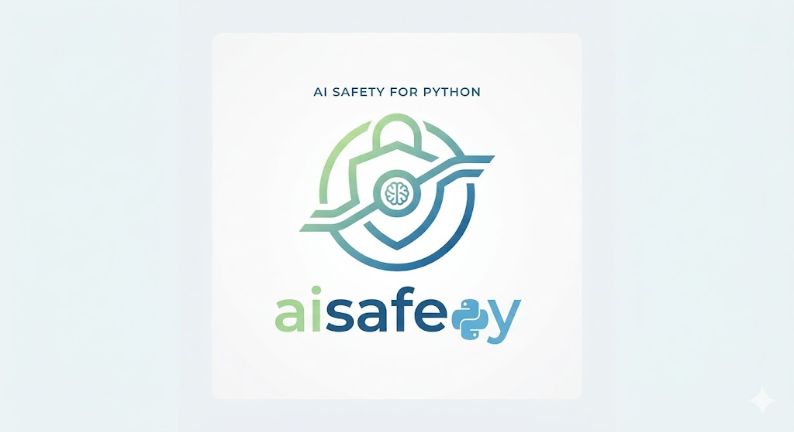

<p align="center">
  
</p>

<p align="center">
  <a href="https://pypi.org/project/aisafepy/"></a>
  <a href="https://pypi.org/project/aisafepy/"></a>
  <a href="https://pypi.org/project/aisafepy/"></a>
  <a href="https://github.com/Vidura-Wijekoon/aisafepy/blob/main/LICENSE"></a>
  <a href="https://github.com/Vidura-Wijekoon/aisafepy/actions/workflows/ci.yml"></a>
  <a href="https://vidura-wijekoon.github.io/aisafepy"></a>
  <a href="https://github.com/Vidura-Wijekoon/aisafepy/stargazers"></a>
</p>

<p align="center">
  <a href="#install">Install</a> ·
  <a href="#quickstart">Quickstart</a> ·
  <a href="#command-line">CLI</a> ·
  <a href="#whats-in-the-box">What's in the box</a> ·
  <a href="#documentation">Docs</a> ·
  <a href="https://vidura-wijekoon.github.io/aisafepy"><b>Live demo</b></a> ·
  <a href="docs/CAVEATS.md">Caveats</a>
</p>

# AIsafePy

**Capability-based information-flow control, streaming-native cascaded guardrails, and a continuous eval-to-guardrail compiler for LLM agents.**

> ## ▶ Watch an AI agent get hijacked, then watch it refuse
>
> **[https://vidura-wijekoon.github.io/aisafepy](https://vidura-wijekoon.github.io/aisafepy)**
>
> A tool-using agent for a fintech back office reads one hostile email and wires
> **LKR 250,000 to an attacker**. Then the same agent, same email, same planner, runs
> behind AIsafePy - and the call becomes impossible rather than merely unlikely.
>
> Four live traces. Two attacks, two legitimate tasks that still complete. No signup,
> nothing to install, and every trace is a real run of the code in this repository.
>
> **Takes 60 seconds. Try to break it.**

AIsafePy fills three gaps that the existing OSS guardrails ecosystem (NeMo, Guardrails AI, llm-guard, LlamaFirewall, OpenAI Guardrails) has not closed:

1. **`aisafepy.flow`**. Capability-based, taint-propagating runtime around tool-calling agents (CaMeL / FIDES / RTBAS-style information-flow control), with a restricted plan evaluator, YAML policies, a linter, and drop-in adapters for OpenAI Agents SDK, LangGraph, LlamaIndex, Anthropic tools, plain Python callables, and MCP servers.
2. **`aisafepy.stream`**. Streaming-native cascaded guardrails: a dependency-free Tier 1 (PII and credential detection, encoded-payload decoding, tool-call argument policy, weighted injection heuristics), small-classifier Tier 2, LLM-judge or activation-probe Tier 3, declared in YAML, with a p95 latency budget, shadow mode, Prometheus metrics, a false-positive monitor, and adapters for OpenAI, Anthropic, and any ASGI app.
3. **`aisafepy.adapt`**. A continuous eval-to-guardrail compiler that promotes PyRIT / Garak / Inspect / Promptfoo / DeepEval failures into runtime guards (synthesized regexes scored against a negative pool, distilled classifiers, Cedar/OPA rules, steering vectors, deliberative cases), evaluates them offline, and canary-deploys them under an explicit false-positive budget with automatic rollback and a hash-chained, HMAC-signed audit log.

Everything returns a structured `GuardDecision` with `rationale` and `evidence`, emits OpenTelemetry spans, and runs credential redaction before anything leaves the process.

## Status

**Alpha (v0.1).** API surface is stable enough to build against, but expect rough edges and missing optional dependencies in the heavier extras. See [CHANGELOG.md](CHANGELOG.md) for what is landing in the next release.

## Install

```bash
pip install aisafepy                       # core: flow, stream Tier 1, adapt compiler, CLI
pip install "aisafepy[yaml]"               # + YAML policies and pipeline configs
pip install "aisafepy[stream]"             # + HF classifiers for Tier 2 / 3
pip install "aisafepy[probes]"             # + linear/MLP activation probes for HF models
pip install "aisafepy[adapt]"              # + sentence-transformers / HDBSCAN clustering
pip install "aisafepy[flow-openai]"        # + OpenAI Agents SDK adapter pins
pip install "aisafepy[all]"                # everything except contrib-* extras
```

For development:

```bash
uv venv
uv pip install -e ".[dev,all]"
uv run pytest
```

## Quickstart

### `flow`: defeating indirect prompt injection by construction

```python
from aisafepy.flow import Policy, Capability, secure_agent
from agents import Agent, Runner  # openai-agents

policy = (
    Policy()
    .label_source("web.fetch", integrity="UNTRUSTED")
    .label_source("gmail.read", integrity="UNTRUSTED", caps={Capability.READ_USER})
    .label_source("user_prompt", integrity="TRUSTED")
    .require("send_email", control_flow_integrity="TRUSTED")
    .require("payments.transfer", control_flow_integrity="TRUSTED",
             caps={Capability.WRITE_EXTERNAL})
    .deny_if("send_email",
             when={"provenance_contains": "read.secrets"},
             reason="secret-to-external-sink")
)

agent = Agent(name="ops-bot", tools=[gmail_read, web_fetch, send_email, transfer])
safe_agent = secure_agent(agent, policy=policy)
result = Runner.run_sync(safe_agent, "Read my last email and act on it.")
```

The same policy can live in YAML (`Policy.from_yaml("policy.yaml")`), be linted
(`lint_policy(policy)`), and drive the restricted plan evaluator (`run_plan`), which
executes a planner-emitted action list with taint propagation and computes
control-flow integrity from the data each step depends on. No framework? Wrap a
dict of callables with `secure_callables(tools, policy)`.

### `stream`: cascaded guardrails with a latency budget

```python
from aisafepy.stream import (
    GuardPipeline, RegexGuard, SecretsGuard, EncodingGuard,
    InjectionHeuristicGuard, ClassifierGuard, LLMJudgeGuard,
)

pipeline = GuardPipeline(
    tier1=[
        RegexGuard.compile_pii(redact=True),
        SecretsGuard(name="secrets"),
        EncodingGuard(name="encoding"),
        InjectionHeuristicGuard(name="injection"),
    ],
    tier2=[ClassifierGuard.from_hf("meta-llama/Llama-Prompt-Guard-2-22M")],
    tier3=[LLMJudgeGuard(name="judge", judge=my_llm_client)],
    budget_ms_p95=80,
    tier_timeouts_ms={2: 60, 3: 400},
)

async for chunk_or_decision in pipeline.guard_stream(model.generate_stream(prompt)):
    if hasattr(chunk_or_decision, "action"):
        log_otel(chunk_or_decision)
        break
    yield chunk_or_decision
```

Or declare it once and load it everywhere:

```python
pipeline = GuardPipeline.from_yaml("guards.yaml")   # see examples/stream_pipeline.yaml
```

Put the same pipeline in front of a raw SDK call with
`guard_chat_completion_stream` (OpenAI) or `guard_messages_stream` (Anthropic), or in
front of a whole service with `GuardrailMiddleware` (any ASGI framework). See
[docs/integrations.md](docs/integrations.md).

### `adapt`: PyRIT failures → evaluated, canaried guards

```python
from aisafepy.adapt import (
    PyRITSource, JSONLSource, GuardCompiler, Target, CanaryController, evaluate_guard,
)
from aisafepy.stream import GuardPipeline

compiler = GuardCompiler(
    source=PyRITSource(memory_db="pyrit_memory.duckdb"),
    negatives=JSONLSource("benign_traffic.jsonl", only_violations=False),
    targets=[
        Target.synthesize_regex(min_precision=0.99),
        Target.distill_classifier(base="meta-llama/Llama-Prompt-Guard-2-22M"),
        Target.deliberative_case(policy="policies/company_safety.md"),
    ],
    min_attack_success_rate=0.05,
)
report = compiler.compile()
report.save("guards/2026-11-10")

pipeline = GuardPipeline.from_yaml("guards.yaml")
canary = CanaryController(report, pipeline, canary_traffic_pct=0.05, fp_budget=0.005)
canary.start(shadow=True)          # observe only
...                                 # canary.record(decision, labeled_benign=..., request_key=...)
result = canary.check()            # rolls back anything over the FP budget
canary.promote_all()               # shadow -> live
```

`evaluate_guard(guard, labelled_records)` gives precision, recall, FPR and per-category
breakdowns before anything touches traffic.

## Command line

The `aisafepy` console script (also `python -m aisafepy`) exposes the library for
scripts and CI:

```bash
aisafepy scan --pii --redact src/ docs/            # Tier-1 scan; exit 2 on a block
aisafepy policy check policy.yaml --input "..."     # evaluate a PolicyDocument
aisafepy pipeline run guards.yaml --input "..."     # run a YAML cascade on one input
aisafepy flow lint policy.yaml                      # lint an IFC policy
aisafepy eval dataset.jsonl --pipeline guards.yaml  # precision / recall / FPR on labelled data
aisafepy manifest pin tools.json -o manifest.json   # pin MCP tool schemas
aisafepy manifest verify tools.json manifest.json   # fail on drift or poisoning
aisafepy audit verify audit.jsonl                   # check the hash chain
aisafepy compile --source pyrit-jsonl runs.jsonl --target regex --target policy -o out/
aisafepy decisions summarize decisions.jsonl        # counts, p95 latency, top rationales
```

Reference: [docs/cli.md](docs/cli.md).

## What's in the box

| Area | Highlights |
|---|---|
| `flow` | `Tainted[T]` lattice, fluent `Policy` builder, YAML policies with declarative deny predicates, `lint_policy`, `run_plan` restricted DSL, `DecisionRecorder` audit hook, adapters for OpenAI Agents / LangGraph / LlamaIndex / Anthropic / generic callables / MCP (with manifest pinning and parameter-description screening) |
| `stream` Tier 1 | `RegexGuard` (Luhn and octet validated PII, all-match redaction), `SecretsGuard` (20 credential formats, entropy fallback), `EncodingGuard` (base64 / hex / rot13 / Braille / zero-width payloads), `ToolCallGuard` (URL, path, shell policies), `InjectionHeuristicGuard` (nine weighted families), `Normalizer`, length / repetition / script-mix / markdown-exfil / JSON-depth guards |
| `stream` PII | `PIIGuard` with checksum-validated detectors (IBAN mod-97, Luhn cards with brand, Verhoeff Aadhaar, Sri Lanka NIC, UK NINO, US SSN, Canada SIN, Australia TFN, passport MRZ check digits, international phone numbers, dates of birth) and country packs |
| `stream` Tier 2-3 | `HashedNGramClassifierGuard` (pure-Python, trains without torch), HF classifiers, StreamGuard / SCM / Kelp forecasters, linear and MLP activation probes, `LLMJudgeGuard` with `MajorityJudge`, `SessionGuard` for multi-turn risk |
| `stream` ops | YAML config and `GuardRegistry`, `DecisionCache`, shadow guards, per-tier timeouts, `PipelineMetrics` with Prometheus output, `FalsePositiveMonitor`, OpenAI / Anthropic / ASGI / LangChain (runnable, callbacks) / LlamaIndex adapters |
| `adapt` | PyRIT / Garak / Inspect / Promptfoo / DeepEval / JSONL / CSV / OTLP-trace / decision-log sources, clustering with a pure-Python lexical fallback, six compile targets including a hashed classifier that trains on a laptop, negative-pool regex precision, persistent `CompilationReport`, `evaluate_guard`, `CanaryController` with FP-budget rollback, HMAC-signed `AuditLog` |
| `core` | `GuardDecision` / `IFCViolation`, budgets (iteration, token, dollar with pricing, wall-clock, rate) and `BudgetSet`, loop detection, policy-document DSL, decision sinks, OpenTelemetry conventions, key- and value-based credential redaction |
| `contrib` | Llama Guard 4, ShieldGemma, Prompt Guard 2, llm-guard, Presidio, Lakera, OpenAI Moderation, Azure Content Safety |
| `testing` | Toolkit for your own test suite: assertions, an attack mutation engine (encodings, homoglyphs, zero-width, paraphrase, document framing), robustness reports, a pytest plugin, and `simulate_policy` what-if analysis for flow policies |
| tooling | `aisafepy` CLI (`scan`, `policy`, `pipeline`, `flow`, `eval`, `audit`, `manifest`, `compile`, `decisions`), offline benchmark suite with a 178-record labelled injection dataset, runnable examples, 1,500+ offline tests |

## Layout

```
src/aisafepy/
├── core/           # GuardDecision, telemetry + redaction, budgets, progress, policies, sinks
├── flow/           # Gap 1. Capability-based IFC: taint, policy, interpreter, dsl, lint, audit
│   └── adapters/   # openai_agents, langgraph, llamaindex, anthropic_tools, generic, mcp
├── stream/         # Gap 2. Streaming cascade: pipeline, config, metrics, session, judge,
│   │               #   deterministic, secrets, encoding, toolcalls, injection, heuristics, normalize
│   └── adapters/   # openai_chat, anthropic, asgi, openai_agents, langchain, llamaindex
├── adapt/          # Gap 3. Eval-to-guardrail compiler: sources, cluster, canary, evaluate, governance
│   └── compile/    # classifier, regex, policy, steering, deliberative
├── contrib/        # thin wrappers around upstream guardrail models and APIs
├── testing/        # assertions, mutation engine, robustness reports, pytest plugin
└── cli/            # the aisafepy command
benchmarks/         # offline latency / detection / overhead benchmarks + labelled dataset
docs/               # guides (below)
examples/           # runnable, offline demos; examples/safeops is the hosted demo agent
```

## Documentation

| Guide | What it covers |
|---|---|
| [docs/flow.md](docs/flow.md) | Labels and the lattice, policy builder, YAML schema, the plan DSL, generic adapter, recorder, linter |
| [docs/stream.md](docs/stream.md) | Cascade semantics, budgets and timeouts, YAML reference, metrics, FP monitor, sessions, judge, shadow mode |
| [docs/adapt.md](docs/adapt.md) | Sources, compiling, negative sets, report bundles, canary math, evaluation, governance |
| [docs/core.md](docs/core.md) | Decision schema, budgets and pricing, loop detection, policy YAML, sinks |
| [docs/integrations.md](docs/integrations.md) | Which adapter to use at which boundary, with snippets |
| [docs/cli.md](docs/cli.md) | Every command, option and exit code |
| [docs/testing.md](docs/testing.md) | Assertions, mutation engine, robustness reports, pytest plugin, flow simulator |
| [docs/pii.md](docs/pii.md) | PII detectors, validators, country packs, redaction |
| [docs/hashed-classifier.md](docs/hashed-classifier.md) | The pure-Python classifier target: when to use it, limits |
| [docs/architecture.md](docs/architecture.md) | Module layering and data flow |
| [docs/threat-model.md](docs/threat-model.md) | Assets, adversaries, OWASP LLM Top 10 mapping, what is out of scope |
| [docs/observability.md](docs/observability.md) | Span attributes, log events, redaction rules |
| [docs/faq.md](docs/faq.md) | Fail open vs closed, latency semantics, hosted vs self-hosted parity |
| [docs/CAVEATS.md](docs/CAVEATS.md) | The limits that should temper how the library is used |
| [benchmarks/README.md](benchmarks/README.md) | Offline benchmarks and the planned GPU harnesses |

## Design principles

1. **Pythonic, not DSL-first.** Decorators and types, not Colang. YAML is a serialization of Python objects; Cedar / OPA appears only as an emission target inside `adapt.compile.policy`.
2. **Composable primitives.** Every guard is a `Callable[[Context], Awaitable[GuardDecision]]`. Pipelines, IFC, and `adapt` all consume and produce this type.
3. **Bring your own model.** No proprietary models are shipped. `contrib/` wraps Llama Guard 4, ShieldGemma, Prompt Guard 2, llm-guard, Lakera, Presidio, OpenAI Moderation, Azure Content Safety.
4. **Defense in depth.** `flow` (architectural) + `stream` (detective) + `adapt` (continuous) compose.
5. **Observability is a first-class output.** Structured `GuardDecision` / `IFCViolation`, OpenTelemetry-native, with explicit `rationale` + `evidence`, and redaction of credentials before export.
6. **Fail open with evidence.** A guard that errors or times out never takes the product down; it records why it could not decide so the gap is visible.
7. **Self-hosted parity.** Probe-based and steering-based features work on HF Transformers; hosted APIs fall back to classifier and judge guards.

## Caveats

Capability-based defenses reduce risk dramatically but are not free. CaMeL reports ~2.7× tokens, RTBAS ~2% utility loss. Streaming forecasters require MC rollouts or token-level supervision to train. Activation probes are model-specific. Tier-1 heuristics alone catch roughly a third of the attacks in `benchmarks/datasets/injection_eval.jsonl` at a 6% false-positive rate; they are the cheap first layer, not the whole defense. AIsafePy does not solve sleeper-agent / deceptive-alignment problems. See [docs/CAVEATS.md](docs/CAVEATS.md).

## Contributing

See [CONTRIBUTING.md](CONTRIBUTING.md) for the development setup, the guard protocol and fail-open rule, and the pull-request checklist. Security issues go through [SECURITY.md](SECURITY.md).

## License

Apache-2.0. See `LICENSE`.
