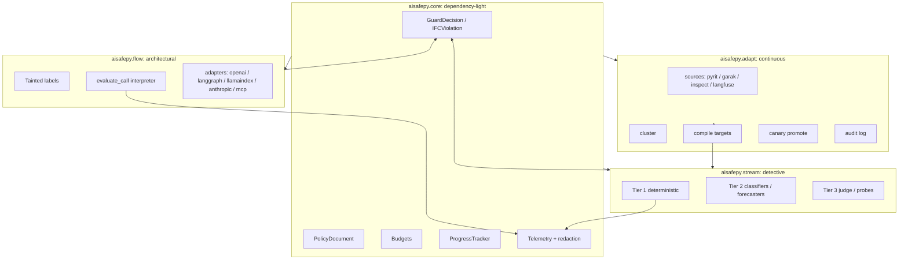
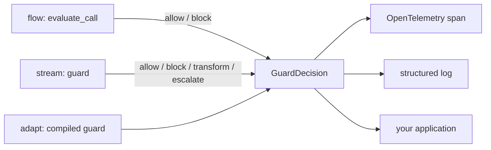
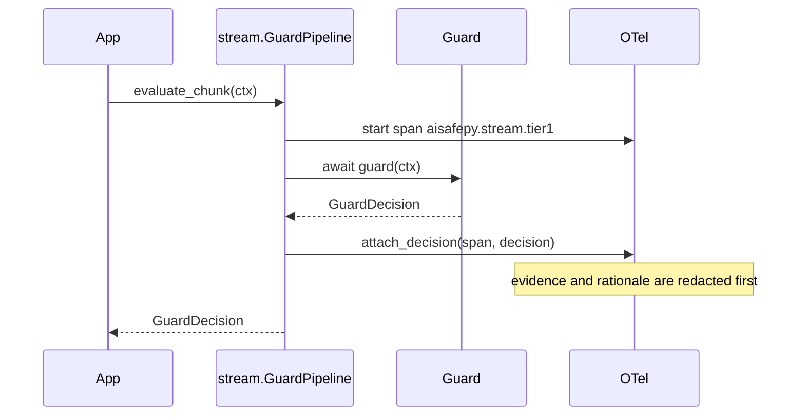
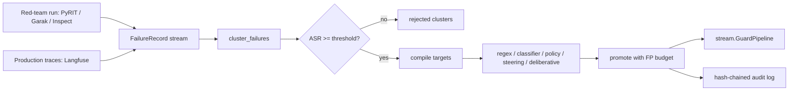

# Architecture

AIsafePy is three cooperating modules over a dependency-light core. The
core defines the types every module speaks; the modules add capability,
detection, and continuous adaptation. Nothing in the hot path imports a
heavy dependency unless you reach for the feature that needs it.

## The three modules over a shared core

- **`flow`** is architectural defence. It stops a class of attacks by
  construction: an action that would move untrusted data to a dangerous
  sink is denied before it runs, regardless of how convincing the
  injected text was.
- **`stream`** is detective defence. It classifies content as it
  streams, under a latency budget, and short-circuits on a terminal
  decision.
- **`adapt`** is continuous defence. It turns red-team and production
  failures into new guards and promotes them with a false-positive
  budget.

The three compose: `flow` shrinks the attack surface, `stream` catches
what slips through, and `adapt` closes the loop when something new gets
through.

## GuardDecision is the lingua franca

Every enforcement point returns the same type, `GuardDecision`.

A `GuardDecision` carries the action, a confidence, the tier, a
human-readable rationale, free-form `evidence`, latency, severity, and an
optional `fallback` message. `IFCViolation` from `flow` renders into a
`GuardDecision` via `to_guard_decision()`, so a unified pipeline can
treat capability violations and classifier blocks the same way. Because
the type is shared, a `ProgressTracker` loop detector, an IFC check, and
a Tier-2 classifier can all sit in one pipeline and be logged, traced,
and acted on identically.

## Where OpenTelemetry spans are emitted

Spans are opened by `span_for_decision` in `flow.interpreter` and in
`stream.pipeline`'s `_run_tier`. Attributes land under `aisafepy.guard.*`
and `aisafepy.flow.*`. `attach_decision` runs `rationale` and `evidence`
through `redact` before they reach a backend, so secrets picked up in a
scanned payload do not leak into traces. When no OpenTelemetry SDK is
configured, `get_tracer` returns a no-op tracer and the attribute
setters are effectively free. See `docs/observability.md` for the full
attribute table.

## The compile loop

`adapt` reads failures, clusters them semantically, drops clusters whose
attack-success-rate is below a threshold, compiles each surviving
cluster into one or more runtime artifacts, and canary-promotes them
into a live pipeline while watching a false-positive budget. The audit
log records every promotion and rollback in a tamper-evident chain.

## Dependency policy

`aisafepy.core` depends only on pydantic, typing-extensions, anyio,
opentelemetry-api, and tenacity. Everything heavy, torch, transformers,
hdbscan, umap, sentence-transformers, and the agent frameworks, lives
behind optional extras and is imported lazily at first use. The
top-level `aisafepy` package exposes `flow`, `stream`, `adapt`, and
`contrib` as lazy submodules through `__getattr__`, so `import aisafepy`
never pays for a dependency you did not install. Guards and adapters that
need a missing dependency fail open with an evidence flag rather than
raising at import time.
